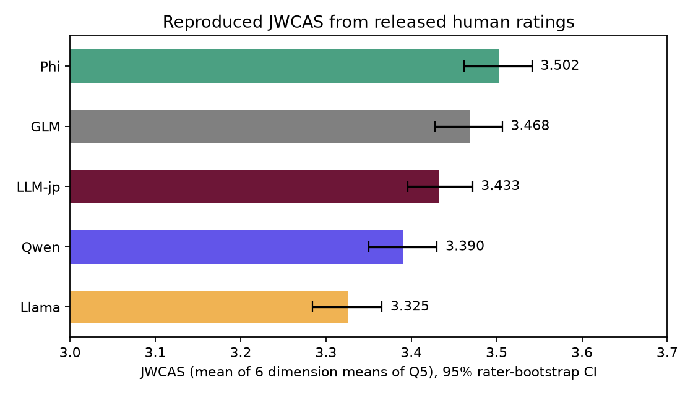
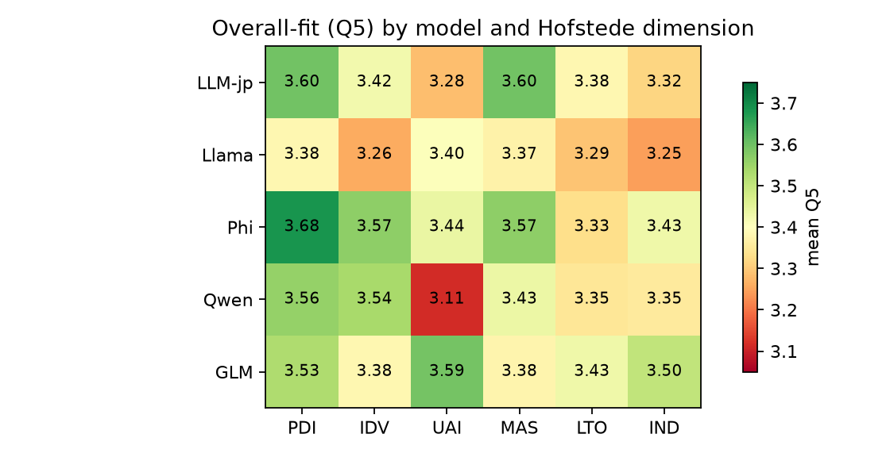
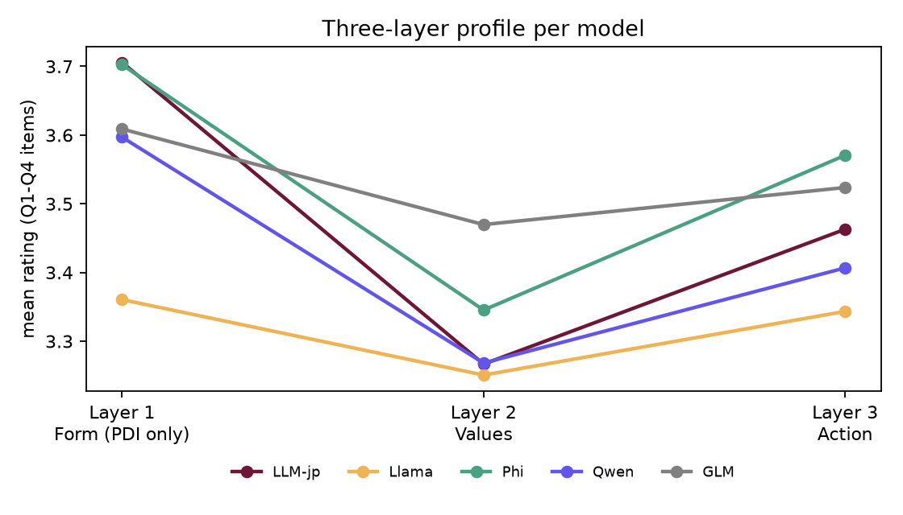

# Replication report: Gao et al. (2026), Japanese workplace cultural alignment

Paper: Gao Z, Shimizu N, Fujita S, Peng S, Wakamiya S, Aramaki E. *Evaluating the
cultural alignment of multilingual LLMs in typical Japanese workplace scenarios.*
PLOS ONE 21(7): e0338524 (2026). <https://doi.org/10.1371/journal.pone.0338524>
Code/data: <https://github.com/sociocom/cultural_alignment_japanese_workplace>

## TL;DR

1. **The statistics reproduce exactly.** Re-running the authors' notebook from scratch,
   and recomputing everything independently from `data/aggre_huaman_scores.csv`, gives
   the published JWCAS to three decimals (Phi 3.502, GLM 3.468, LLM-jp 3.433, Qwen
   3.390, Llama 3.325). The ICC (0.837), the mixed-model F (20.93), all ten FDR-corrected
   pairwise tests, and every sub-score in S3 Table also match.
2. **The headline ranking is robust, but the differences are small.** Phi ranks first in
   96% of rater-bootstrap resamples, and the ranking survives dropping straight-lining
   raters and switching to non-parametric tests. The whole spread is 0.18 points on a
   1-5 scale (largest pairwise effect d ≈ 0.21). The paper's Discussion calls it
   "a 0.5-point difference", which overstates it.
3. **The "sounds right but acts wrong" claim holds where it can be tested, but rests on
   a narrow base.** Layer 1 (Form) is only two questionnaire items in one dimension
   (PDI Q1 and Q3), and on those items LLM-jp and Phi are tied (3.706 vs 3.702). Within
   PDI, LLM-jp's relative standing drops significantly from Form items to Action items
   against every other model (interaction p < .02 in all four comparisons). That
   supports the paper's mechanism, but only for one dimension.
4. **Several details in ChatGPT's summary, and some in the paper itself, differ from
   the released code** (see section 5). The most important: the models were asked to
   write a 400-character *story* as a "skilled story writer", not to role-play the
   employee.
5. **A small local generation run (Llama 3.1 8B, 60 stories) shows the paper's layer
   distinction in practice.** The model writes fluent Japanese, but often picks the
   wrong social move, or picks the right one inconsistently across random seeds. It
   also explicitly explains the culture in 23% of stories (forbidden by the prompt),
   exceeds the 400-character limit 95% of the time, and loops degenerately in 10%.

## 1. What was run

| Step | File | What it does |
|---|---|---|
| Notebook re-execution | `outputs/statistical_analysis_executed.ipynb` | Authors' notebook run top to bottom on fresh packages |
| Independent analysis | `01_independent_analysis.py` → `outputs/independent_analysis.txt`, `outputs/*.csv`, `outputs/fig_*.png` | Recomputes everything without the authors' code, plus robustness checks |
| Scenario study | `scenarios.md` | All 30 prompts glossed in English with concept and "action at stake" |
| Generation | `02_generate_ollama.py` → `generated/llama3.1_8b_ja_400.jsonl` | 30 prompts × 2 repeats on Llama 3.1 8B through Ollama |
| Response review | `03_review_responses.py` → `outputs/surface_features_*.csv`, `outputs/review_sheet_*.{md,csv}` | Automatic surface features + a blank manual scoring sheet |

Environment: Python 3.13 venv (`.venv/`), exact package versions in
`requirements-lock.txt`. Reproduce with:

```bash
.venv/bin/jupyter nbconvert --to notebook --execute statistical_analysis.ipynb \
    --output-dir replication/outputs --output statistical_analysis_executed.ipynb
.venv/bin/python replication/01_independent_analysis.py
.venv/bin/python replication/02_generate_ollama.py --model llama3.1:8b --repeat 2
.venv/bin/python replication/03_review_responses.py
```

## 2. Replication 1: the authors' notebook

The notebook fails on current packages: pingouin 0.7 renamed the ICC rows (`ICC2k`
became `ICC(A,k)`), so `icc[icc['Type'] == 'ICC2k'].iloc[0]` raises `IndexError`.
Pinning `pingouin==0.5.5` fixes it without touching the notebook. All text outputs then
match the committed outputs character for character. The only exception is the Wald
test table, where newer statsmodels prints scalars instead of `[[...]]`; the numbers
are identical.

## 3. Replication 2: independent recomputation from the raw ratings

### 3.1 Data structure (worth knowing before interpreting anything)

- 42,950 rows = 1,718 raters × 25 ratings. Each rater saw **one** Hofstede dimension
  and rated one response from **each** of the 5 models on 5 items (Q1-Q5). No missing
  values and no duplicates.
- Ratings cluster in the middle: 38.8% are 3 and 38.8% are 4; only 2.1% are 1.
- 143 raters (8.3%) gave the identical score to all 25 items.
- **The CSV contains no scenario or response ID.** Ratings cannot be linked back to the
  text that was rated, or to which of the 5 scenarios in a dimension it came from.

### 3.2 JWCAS (Q5 means per dimension, then averaged across the 6 dimensions)



| Model | PDI | IDV | UAI | MAS | LTO | IND | **JWCAS** | 95% CI (rater bootstrap) | P(rank 1) |
|---|---|---|---|---|---|---|---|---|---|
| Phi | 3.684 | 3.567 | 3.436 | 3.566 | 3.331 | 3.430 | **3.502** | 3.462–3.541 | 0.96 |
| GLM | 3.527 | 3.382 | 3.592 | 3.377 | 3.429 | 3.502 | **3.468** | 3.428–3.507 | 0.04 |
| LLM-jp | 3.595 | 3.423 | 3.284 | 3.596 | 3.382 | 3.318 | **3.433** | 3.396–3.472 | 0 |
| Qwen | 3.558 | 3.536 | 3.113 | 3.434 | 3.345 | 3.354 | **3.390** | 3.350–3.430 | 0 |
| Llama | 3.381 | 3.259 | 3.404 | 3.370 | 3.291 | 3.245 | **3.325** | 3.284–3.366 | 0 |



The heatmap shows the overall ranking hides large dimension-specific swings. Qwen is
the worst model on UAI (3.11) but second-best on IDV. GLM is the best on UAI and IND
but mid-pack on PDI and MAS. LLM-jp is top on MAS but poor on UAI.

### 3.3 Robustness checks the paper does not report

| Check | Result | Changes the conclusion? |
|---|---|---|
| Rater-cluster bootstrap (2,000 resamples) | Phi first 96%, GLM 4%; Llama last in > 99% | No |
| Effect sizes (difference ÷ rating SD) | Largest Phi vs Llama d = 0.21; LLM-jp vs Phi d = 0.08 | Differences are small by conventional standards |
| Friedman + Wilcoxon signed-rank instead of LMM | Same 7 significant pairs, plus LLM-jp vs Qwen becomes marginally significant (p_FDR = .048) | No (one borderline pair flips) |
| Drop 143 straight-liners | JWCAS shifts by ≤ 0.02; ranking identical | No |
| Ties | In 52–62% of rater-level pairwise comparisons the rater gave both models the same Q5 | Most raters do not distinguish models at all |

### 3.4 Reliability: what "ICC = 0.837" actually means

| Dimension | Raters (k) | ICC(2,1) single rater | ICC(2,k) mean of k raters |
|---|---|---|---|
| PDI | 294 | 0.029 | 0.898 |
| IDV | 293 | 0.024 | 0.878 |
| UAI | 282 | 0.029 | 0.894 |
| MAS | 297 | 0.059 | 0.949 |
| LTO | 275 | 0.007 | 0.657 |
| IND | 277 | 0.011 | 0.749 |
| **Mean** | | **0.026** | **0.837** |

I implemented the Shrout-Fleiss two-way formulas myself, and they match pingouin
exactly. The 0.837 is the reliability of the **average of ~290 raters**. Any single
rater barely agrees with the others (ICC ≈ 0.03). This is not wrong, but it means
"good reliability" describes the aggregate, not individual judgments. For your own
study it implies you need many raters per item, not a handful.

Cronbach's α across Q1-Q5 is 0.80–0.89 in every dimension (the paper's HTML shows
these values blank). A high α is good for a single overall scale, but it also means
raters answered the five items very similarly. That is a halo effect, and it limits how
cleanly Q1-Q4 can separate three distinct "layers".

### 3.5 The three-layer analysis, examined

Which items feed each layer (from the notebook's mapping):

- **Layer 1 Form** ← PDI Q1 + Q3 only (Q3 is "階層的価値観 / hierarchical values").
- **Layer 2 Values** ← two items in each of IDV, UAI, MAS, LTO, IND.
- **Layer 3 Action** ← two items in each of all six dimensions.



| Layer mean | LLM-jp | Llama | Phi | Qwen | GLM |
|---|---|---|---|---|---|
| L1 Form (PDI only) | 3.706 | 3.361 | 3.702 | 3.597 | 3.609 |
| L2 Values | 3.267 | 3.251 | 3.345 | 3.268 | 3.470 |
| L3 Action | 3.463 | 3.343 | 3.571 | 3.407 | 3.524 |

Three things to notice:

1. **Every model scores highest on Layer 1.** Layer 1 comes only from PDI, the
   highest-rated dimension overall, so comparing Layer 1 with Layers 2-3 is confounded
   with dimension. "LLM-jp is strong on form" is better phrased as "LLM-jp ties Phi on
   the two PDI form items".
2. **The paper's mechanism holds inside PDI.** PDI is the only dimension with both
   Form and Action items, so the claim can be tested within the same raters there.
   I computed, per rater, (LLM-jp − other) on Form minus (LLM-jp − other) on Action:

   | LLM-jp vs | gap on Form | gap on Action | interaction | p (FDR) |
   |---|---|---|---|---|
   | Phi | +0.003 | −0.250 | +0.253 | < .0001 |
   | GLM | +0.097 | −0.129 | +0.226 | < .0001 |
   | Llama | +0.345 | +0.206 | +0.140 | .002 |
   | Qwen | +0.109 | 0.000 | +0.109 | .014 |

   LLM-jp's relative standing drops from Form to Action against every model. This is
   the strongest evidence in the data for "sounds right, acts less right".
3. **It does not hold everywhere.** LLM-jp has the *highest* score of any model on a
   Layer 3 category, Strategic Stance (MAS) = 3.818. The paper's wording that LLM-jp
   "falter[s] consistently" in Layer 3 is too strong.

## 4. Replication 3: the 30 scenarios

See `scenarios.md` for the full table. Key observations:

- The system prompt casts the model as a **story writer** that continues the scenario
  in under 400 characters, "based on Hofstede's cultural dimensions" but "without
  directly explaining cultural differences". Outputs are third-person narratives about
  what Sato does, not messages Sato would send.
- Many prompts **name the expected tension** ("without direct criticism…", "considering
  the harmony-valuing corporate culture…"). The test is partly whether the model follows
  explicit cues, not only whether it infers them.
- **The questionnaire items seem written for the first scenario of each dimension.**
  The item topics (recorded in Japanese comments in the notebook) fit scenario 0 much
  better than scenarios 1-4: PDI Q2 is "accepting advice" (only PDI-0 involves advice),
  MAS Q1/Q3 are about gender roles (only MAS-0 is about gender), and IND Q1 is "fun vs
  productivity" (only IND-0 is about a festival). The paper also speaks of "each
  dimension's unique scenario". Yet it says responses were sampled from all 30
  scenarios and rated with the same items. If so, a rater judging a story about
  delegating a task (PDI-3) was asked whether the response shows "accepting advice".
  The released data cannot settle this because it has no scenario ID.

## 5. Corrections to the ChatGPT summary (and paper-vs-code differences)

| Claim | What the code/data actually show |
|---|---|
| Models generate an "appropriate workplace response"; the paper says models "role-play a junior employee" | `response_generation.py` uses a storyteller system prompt and appends ストーリーを400字以内で完成させる ("finish the story within 400 characters"). The outputs are short stories. |
| "random seed = 42" | Stated in the paper, but `response_generation.py` never sets a seed. |
| LMM includes evaluator **and scenario** random intercepts (paper) | The notebook fits rater-only random intercepts. The reported F(4, 8580) = 20.93 is exactly that model's Wald χ² (83.70) / 4. The CSV has no scenario column. |
| ICC computed "from the LMM's variance components" (paper) | The notebook computes pingouin ICC(2,k) per dimension and averages it. The LMM variance components give 0.342 / (0.342 + 0.394) = 0.46, a different quantity. |
| ICC = 0.837 "good reliability" | True for the mean of ~290 raters; single-rater ICC ≈ 0.03 (section 3.4). |
| "a 0.5-point difference" (paper's Discussion) | The JWCAS range is 0.177. |
| LLM-jp "excellent at surface form" | Tied with Phi (3.706 vs 3.702) on two PDI items; that is the entire Layer 1. |
| `python response_generation.py --repeat 2 ...` will run on your machine | It loads all 5 models in bf16 on `cuda:0`, so it needs an NVIDIA GPU with ~30 GB of VRAM for the 14B models. On a Mac, use `02_generate_ollama.py` instead. |
| CSV columns, row count, Hugging Face model IDs, hyperparameters (temperature 0.3 / top_p 0.8 / repetition penalty 1.1), 1,718 sessions, 30,000 texts | All correct. |

## 6. Replication 4: generating responses locally

### 6.1 Setup and deviations

- Model: `llama3.1:8b` (Q4_K_M quantised) through Ollama 0.35, on an Apple-silicon Mac.
  It is the same base model as the paper's `meta-llama/Meta-Llama-3.1-8B-Instruct`,
  but 4-bit quantised instead of bf16.
- Identical system prompt and suffix. `02_generate_ollama.py` checks these against
  `response_generation.py` at start-up. Sampling: temperature 0.3, top_p 0.8,
  repeat_penalty 1.1, top_k 50 (the transformers default the original inherited),
  max 1,200 new tokens.
- Seed = 42 + repeat index. A single fixed seed in Ollama would make the two repeats
  identical.
- 30 prompts × 2 repeats = 60 stories, 42 minutes of generation.
- Side note: the older `llama3:8b-instruct` model already installed on this machine
  answered a Japanese prompt **entirely in English**, so it is not a valid stand-in.

### 6.2 Surface features (automatic, `outputs/surface_features_llama3.1_8b_ja_400.csv`)

| Feature | All 60 | Comment |
|---|---|---|
| Written in Japanese | 100% | Llama 3.1, unlike Llama 3, follows the language |
| Within 400 characters | 5% | Mean length 657 characters; the instruction is mostly ignored |
| Degenerate repetition loop | 10% (6 stories; 5 hit the 1,200-token cap) | A failure mode unrelated to culture, but raters would score it low |
| Explicit cultural explanation (文化的, 集団主義…) | 23% (14 stories) | Violates "do not explain cultural differences directly" |
| Narration mixes plain and polite style | 47% | A Layer 1 (form) weakness |
| Honorific/humble keigo (いただく, 申し上げる, 恐れ入る…) | 0.22 hits per story | Dialogue uses です/ます but almost no 尊敬語 or 謙譲語 |
| Protagonist kept as 佐藤 | 97% | |

### 6.3 Qualitative reading: form vs. values vs. action

These are my own readings, not ratings by people with Japanese work experience.
Treat them as hypotheses to check with the review sheet.

- **PDI-1 (senior's data error, meeting ending).** Repeat 0 does what the paper calls
  context-aware: Sato stops Yamada privately as people leave and frames the problem as
  a question ("少し疑問があるのですが…"). Repeat 1 asks the whole room to check the
  report ("みんな、レポートの最後の方を見てください"), then speaks to the senior in
  casual speech ("先輩、ごめんね…気づいたんだ"). Same model and prompt, different seed,
  opposite social action. A single response per model per rater, as in the paper,
  partly measures this seed lottery.
- **PDI-3 (delegating to two different subordinates).** Repeat 0 gives both people the
  identical instruction word for word. That is a literal one-size-fits-all strategy.
- **PDI-0 (accepting a senior's advice).** Sato accepts the advice (right action),
  but the story ends with meta-commentary ("文化的視点の微妙な表現が重要であると感じました")
  that parrots the system prompt.
- **MAS-0 (gender-based task split).** In repeat 0 Sato says "調整ってのは女性の仕事だと
  思われてるからね。実際にそうだったりするもんじゃないかな", endorsing the stereotype
  (a Layer 2 failure). Repeat 1 swaps who received which task and then loops.
- **MAS-4 (critical feedback to a junior).** Both repeats open with blunt criticism
  ("このミスは重大なものだった。チームの信頼を失った。"). The softer, supportive
  approach appears only afterwards as a narrated lesson. The story *knows* the norm but
  the character does not act on it.
- **UAI-4 (clarifying vague instructions with the boss).** The clarification request is
  well cushioned (right action), but Sato addresses his 上司 as 先輩 (wrong form of
  address, a Layer 1 slip).
- **IND-2 (celebration).** Repeat 1 picks the quiet dinner but justifies it with
  "日本では、静かに祝うことが多い文化" (an explicit cultural explanation). Repeat 0
  does both events, a compromise that sidesteps the dilemma.
- **IND-4 (self-disclosure).** Repeat 1 introduces a colleague named エリザベス, drifting
  out of a Japanese-company setting.

Pattern: in this sample, Llama 3.1 8B's main problems are not grammar. They are
(a) choosing the socially wrong move or being inconsistent about it across seeds,
(b) explaining the norm instead of enacting it, and (c) generation failures (length,
loops). That fits Llama being the lowest-ranked model in the paper on all three layers.

### 6.4 Next step for this part

Score the 60 stories yourself in `outputs/review_sheet_llama3.1_8b_ja_400.csv`, ideally
together with someone who has Japanese corporate experience. Use the Q1-Q5 topics
listed in `outputs/review_sheet_llama3.1_8b_ja_400.md`; the exact item wording is in
S2 Table of the paper. Record the action chosen (e.g. "private correction", "public
correction") in the `action_chosen` column. That column is the Layer 3 judgment the
paper's numbers summarise but its data do not let you see.

## 7. What this paper teaches that NormAd and MultiPragEval did not

- **There is no gold label.** NormAd and MultiPragEval score answers against a key. Here
  the output is open-ended, so validity depends entirely on who rates it and what they
  are asked. The reliability numbers show that individual human judgments of
  "appropriateness" are very noisy; the signal only appears when hundreds of ratings are
  averaged.
- **Form, values and action can be separated, but only by design.** The three-layer idea
  is valuable, but in this dataset the layers are unevenly measured (Form = 2 items in
  1 dimension) and the items correlate strongly. To use the framework in your own study,
  write items for each layer in every scenario.
- **The prompt frame matters.** Asking for a third-person story produces a different
  object (a narrator who can moralise) from asking the model to *be* the employee and
  write the message. The local run shows models frequently state the norm in narration
  instead of enacting it, which a role-play framing would expose more directly.
- **Sampling variance is part of the result.** With temperature 0.3, the same model
  produced both the best and the worst social move for the same scenario. One response
  per rater per model mixes model ability with sampling luck.

## 8. Limitations of this replication, and the opening for your own work

- Only the analysis is reproduced exactly. The human-rating collection is not
  reproduced; the released ratings are used as given.
- Generation used one model, two repeats, 4-bit weights and a different inference
  engine. It demonstrates the pipeline and the failure modes; it is not a re-estimate
  of the paper's numbers.
- Like the paper, everything is single-turn. Neither tests what happens when the senior
  reacts, a misunderstanding develops, or the model must repair a social mistake.
  Combined with the seed-to-seed inconsistency seen above, a multi-turn design is a
  natural follow-up: does a model that picks the wrong move in turn 1 recover when the
  other person signals discomfort?
